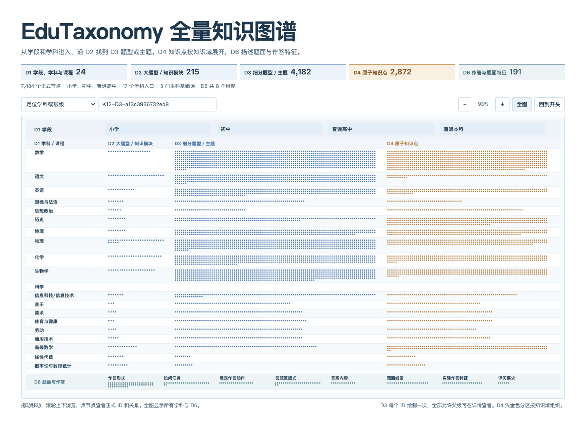
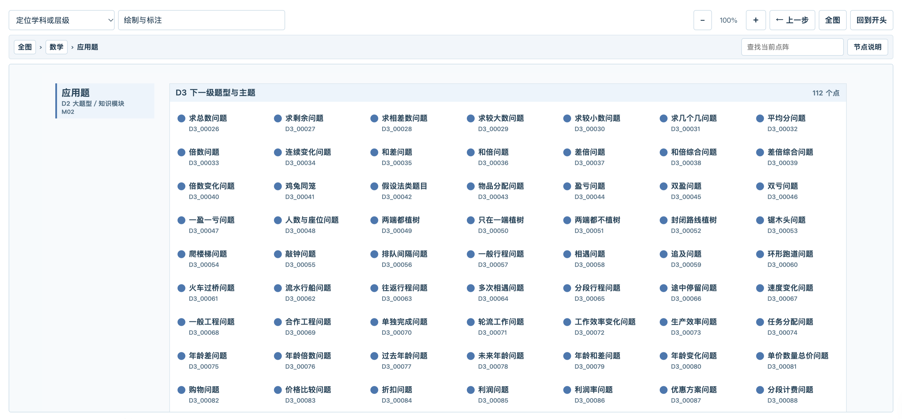

# EduTaxonomy

**从教材拆解到教育知识图谱。**

EduTaxonomy 以教材目录、章节知识与学习任务为起点，通过知识原子化、证据记录、术语归一和关系校验，将分散在不同学段、教材与课程中的内容组织成统一分类体系，为题目理解、知识检索、训练数据组织和教育任务生成提供结构化标签。

[在线展示](https://znxzsy.github.io/EduTaxonomy/) · [构建方法](docs/methodology.md) · [交互样例](https://znxzsy.github.io/EduTaxonomy/#demo) · [获取完整版本](#获取完整版本)

## 完整体系总图

当前目录包含 **7,484 个正式节点**，组织小学、初中、普通高中及部分本科基础课程，具有 17 个 K12 学科入口和 3 门本科课程入口。



| 层级 | 组织内容 | 节点数 |
| --- | --- | ---: |
| D1 | 学段、学科与课程 | 24 |
| D2 | 学习任务、大题型或教材知识模块 | 215 |
| D3 | 细分题型、问题模型与知识主题 | 4,182 |
| D4 | 原子知识点 | 2,872 |
| D6 | 题面与作答特征 | 191 |

这些数字表示当前分类目录规模，教材版本覆盖、知识粒度与具体映射仍需持续审校。D5 已停用，保留其余层级编号。

## 数学细节

以“应用题”为例，求总数、平均分、和差、倍数、鸡兔同笼、行程和工程分别对应不同问题模型。分类保留学生面对的学习任务，同时将解题过程中调用的知识点单独组织。



两张图均为完整体系的展示图。仓库中的可交互数据与下载文件只开源其中一部分。

## 怎样从教材构建图谱

教材给出了章节次序、知识内容和例题线索；实际题目还包含问题模型、表达形式和作答要求。EduTaxonomy 将这些信息拆分为不同类型的对象，再通过证据与类型约束建立关联。


**结构约束的知识原子化。** 按学科、学段、版本和章节组织材料，抽取概念、性质、规律、方法、例题与习题中的知识候选。原始候选保留上下文、材料定位和处理状态，后续归并仍能追溯原始记录。

**证据保留的实体对齐。** 对名称与内容做规范化，分别生成重复、同义、跨版本映射和依赖关系候选。名称相近只触发审核，不直接合并知识实体；相同知识的多份来源也不因归并而丢失。

**任务与知识的分层建模。** D2/D3 组织任务和问题模型，D4 维护独立知识点。一个任务可以引用多个知识点，同一个知识点也可以被不同任务和课程复用。

**分面属性与受约束检索。** D6 将作答形式、设问任务、动作、版式、答案内容、题面线索、实际作答特征和评阅要求分别维护。题目映射结合学段与学科范围、词项匹配、字符特征检索以及多轮候选扩展，再检查正式 ID、父级和关系类型。

具体表示、候选对齐与检索机制见[方法说明](docs/methodology.md)。

## 部分开源

本仓库开源图谱可视化浏览器、数据结构说明和部分数学样例。开源样例共 75 个节点，包括 3 个数学模块、40 个细分题型与主题、12 个知识点和少量 D6 属性，用于运行和复现交互。

[样例 CSV](examples/math-nodes.csv) · [样例字典 JSON](examples/math-taxonomy.json)

页面内嵌数据与下载文件使用相同的开源范围。完整知识库、完整 Excel、教材原文与拆书生产资产不随本仓库分发。

## 获取完整版本

如需完整知识图谱、分类字典，或交流教材拆解、知识建模与教育数据应用，请联系作者本人微信：**znxzsy**。

## 本地运行与开发

下载仓库后直接打开 `index.html` 即可查看展示图和交互样例。页面不调用远端模型接口，也不收集用户输入。下载按钮需要保留仓库目录结构。

也可以启动静态文件服务，在浏览器中打开命令输出的本地地址：

```bash
python3 -m http.server 8080
```

修改后使用 Node.js 18+ 和 Python 3.9+ 构建与校验，无需安装第三方依赖：

```bash
node scripts/build.mjs
node --check src/app.js
python3 -m unittest discover -s tests -v
python3 scripts/audit.py
```

`src/` 保存页面源码，`examples/` 保存开源样例。字段和关系见[数据结构](docs/schema.md)，公开内容边界见[发布说明](docs/public-release.md)。

## License

本仓库发布内容采用 [MIT](LICENSE)。
